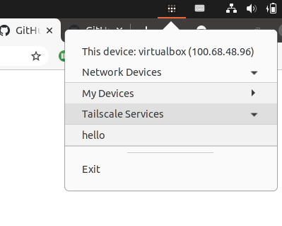
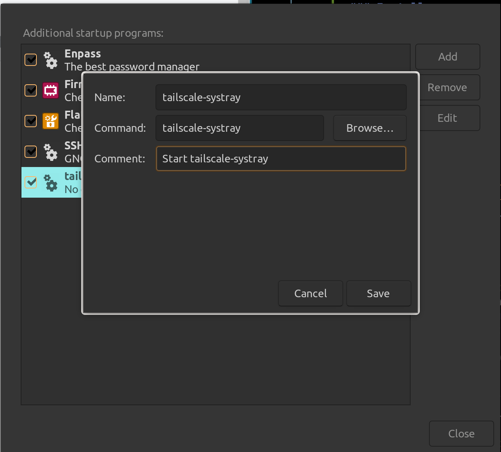

# tailscale-systray

Linux port of tailscale system tray menu.



## Usage

```
$ tailscale-systray
```

## Requirements

* tailscale

## Installation

### Install requirements

Building app requires go

```
sudo apt-get install golang-go
```

### Install app

```
go install -v github.com/mattn/tailscale-systray@latest
```

At this point you can start it with `$HOME/go/bin/tailscale-systray`.

### Run at startup

You can do this in different ways. One option is to add the command to "Startup Applications" if your system has it:



## License

MIT

Icon file is copied from official repository.

## Author

Yasuhiro Matsumoto
